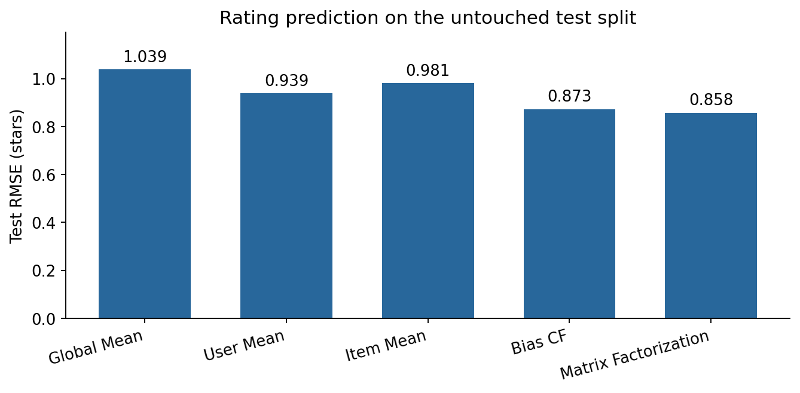
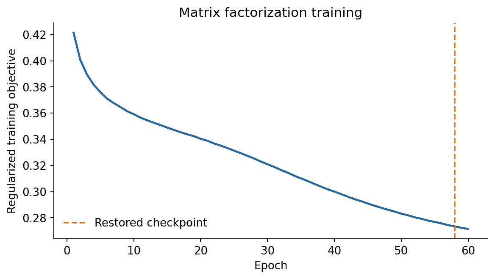
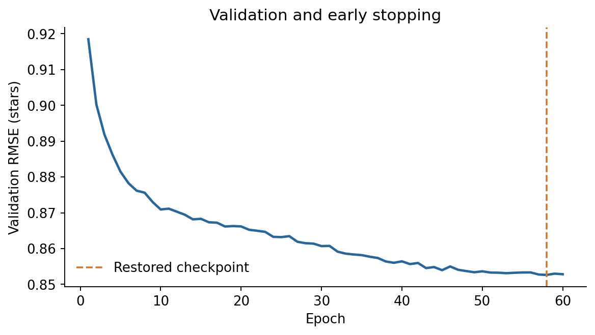
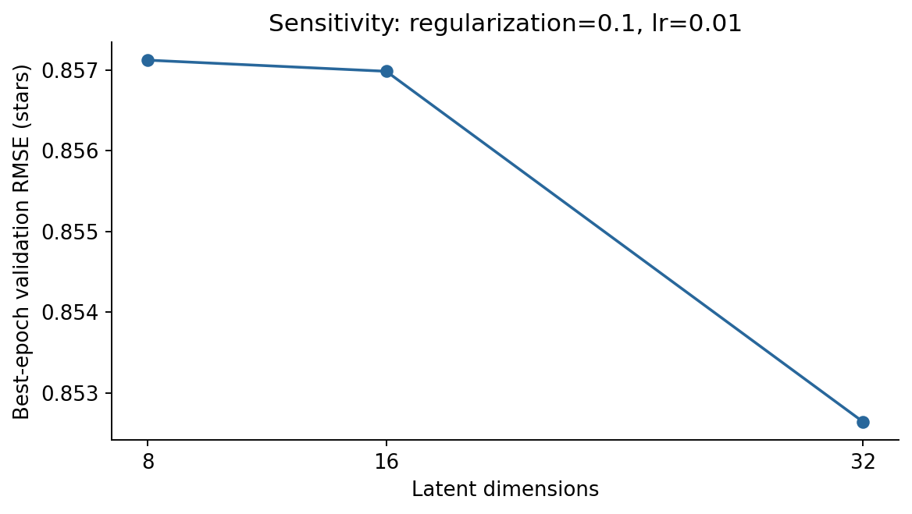
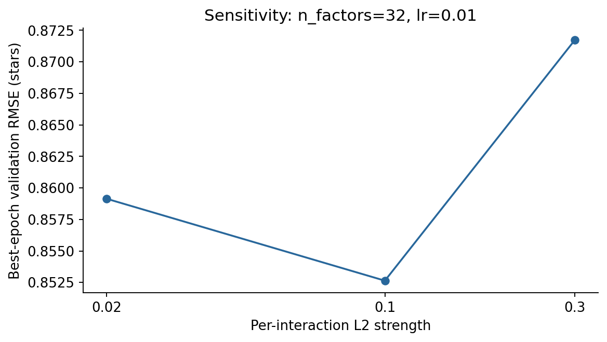
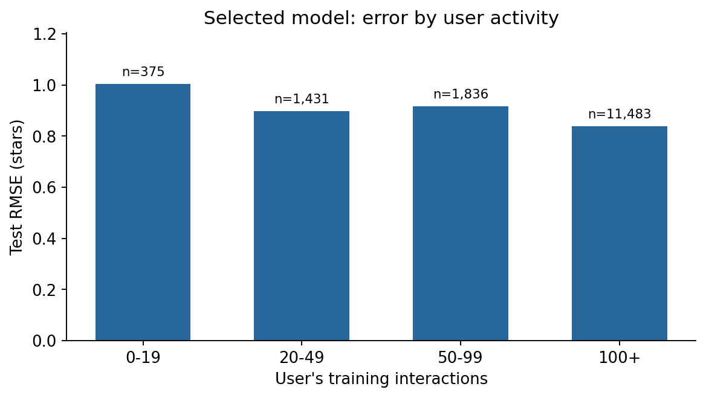

# Movie Recommendation System

A reproducible explicit-feedback recommendation project using MovieLens Latest Small.
It compares five rating predictors, implements biased matrix factorization with NumPy,
and connects model selection, offline evaluation, saved artifacts, and a recommendation CLI.

The motivation is to understand what personalization adds beyond simple averages while
building an experiment that can be audited and rerun on a laptop. The main result is
**0.8578 test RMSE**, compared with **1.0389** for the global-mean baseline. Full-catalogue
ranking is also measured and exposes a substantial gap between rating accuracy and useful
Top-K retrieval.

## Quick start

Python 3.10–3.13 is supported; the recorded experiment used Python 3.12.9 on Windows.
The following commands use Ubuntu/macOS shell syntax and require no GPU.

```bash
git clone https://github.com/yumumumule/movie-recommendation-system.git
cd movie-recommendation-system
python3 -m venv .venv
source .venv/bin/activate
python -m pip install -r requirements.txt
python -m pip install --no-deps -e .
python -m scripts.download_data
python -m scripts.verify_reproduction
python -m src.train
python -m src.recommend --user-id 1 --top-k 10
python -m pytest -q
python -m ruff check .
```

On Windows, use `py -3.12 -m venv .venv` and `.venv\Scripts\Activate.ps1`.
The repository is private, so cloning requires access through your GitHub credentials.
Model files and raw data are deliberately excluded from Git; `src.train` rebuilds the
selected checkpoint from the committed configuration without repeating parameter search.

## Dataset

[MovieLens Latest Small](https://grouplens.org/datasets/movielens/latest/) is published by
GroupLens at the University of Minnesota. The downloaded September 2018 snapshot contains
100,836 ratings from 610 anonymized users, 9,724 rated movies, and a catalogue of 9,742 movies.
Ratings range from 0.5 to 5 stars in half-star steps. Only `ratings.csv` and `movies.csv`
are used; genres and titles are display metadata, not model features.

The downloader retrieves the [official archive](https://files.grouplens.org/datasets/movielens/ml-latest-small.zip),
checks ZIP integrity, and extracts an explicit allowlist of files. Loading rejects missing
fields, null or non-finite values, invalid ratings or IDs, duplicate user/movie pairs,
and catalogue inconsistencies rather than silently imputing labels. Raw IDs are preserved
at API boundaries and mapped to sorted contiguous indices using training data only.
The archive and CSV fingerprints are recorded in [data/checksums.json](data/checksums.json).

MovieLens is a mutable development dataset, not a stable research benchmark. The snapshot
hashes identify exactly which data produced these results. Data and derived artifacts have
[GroupLens usage conditions](results/DATA_LICENSE.md), separate from the source-code MIT license.

## Methods

| Model | What it captures | Main limitation |
| --- | --- | --- |
| Global Mean | Overall training rating level | No personalization or item preference |
| User Mean | Individual rating generosity | Cannot distinguish movies for one user |
| Item Mean | Each movie's empirical average | Sparse items have noisy averages |
| Bias CF | Regularized user and movie effects | No user–movie interactions |
| Matrix Factorization | Biases plus learned user–movie interactions | Requires observed history; optimizes rating error |

The bias model predicts:

$$\hat r_{ui}=\mu+b_u+b_i.$$

It fixes $\mu$ to the training mean and uses alternating exact coordinate updates to minimize
$\sum_{(u,i)\in T}(r_{ui}-\mu-b_u-b_i)^2+\lambda_b(\sum_u b_u^2+\sum_i b_i^2)$.

Matrix factorization adds a latent interaction:

$$\hat r_{ui}=\mu+b_u+b_i+p_u^\top q_i.$$

Its training objective uses **per-interaction regularization**:

$$\mathcal L=\frac{1}{2|T|}\sum_{(u,i)\in T}\left[(r_{ui}-\hat r_{ui})^2+
\lambda(b_u^2+b_i^2+\lVert p_u\rVert^2+\lVert q_i\rVert^2)\right].$$

This weights an entity's total penalty by its number of training interactions. It differs
from the bias model's entity-level penalty, so their regularization values are not comparable.
Each shuffled mini-batch sums gradients from one pre-update parameter snapshot; NumPy's
`add.at` correctly accumulates repeated IDs. The learning rate scales the **summed** batch
gradient, so changing batch size requires reconsidering the learning rate. No recommender
library supplies the model or optimizer.

Optimization uses unclipped scores. Evaluation and recommendations clip predictions to
[0.5, 5]. Unknown users/items contribute zero bias and zero latent interaction; a known
counterpart's bias is retained. Two unknown entities fall back to the training mean.
User/item means likewise fall back to the global mean when their required entity is unknown.

## Experimental setup

- Seed: **42**, using NumPy's local random generator.
- Global random interaction split: **70,586 train / 15,125 validation / 15,125 test**.
- Each user/movie pair occurs in exactly one split. Mappings, means, and model parameters
  use training data only; no warm-start filtering removes difficult test cases.
- The MF grid contains 18 combinations: dimensions `{8,16,32}`, L2 `{0.02,0.1,0.3}`,
  and learning rates `{0.005,0.01}`. Batch size is 256, with at most 60 epochs.
- Early stopping has patience 7 and minimum improvement 0.00001; the lowest validation-RMSE
  checkpoint is restored, including when the epoch cap is reached.
- Bias CF searches regularization `{1,5,10,20}` using 30 coordinate-descent passes.
- Hyperparameters, stopping time, and the overall model choice use validation RMSE.
  Choices and fitted artifacts are saved **before** the single final test phase.
- Reported models remain fitted on training data, without a train+validation refit.
  MAE, activity analysis, and ranking results do not influence model selection.

This split measures missing-rating interpolation, not forecasting future behavior.
Timestamps are retained for integrity checks but are not used as model inputs.

## Results

Measured on the independent test split; lower RMSE/MAE is better.

| Model | Validation RMSE | Test RMSE | Test MAE |
| --- | ---: | ---: | ---: |
| Global Mean | 1.0423 | 1.0389 | 0.8228 |
| User Mean | 0.9464 | 0.9391 | 0.7303 |
| Item Mean | 0.9726 | 0.9808 | 0.7594 |
| Bias CF | 0.8641 | 0.8733 | 0.6689 |
| **Matrix Factorization** | **0.8526** | **0.8578** | **0.6571** |

The selected MF model has **32 factors, learning rate 0.01, L2 0.1**, and checkpoint
**epoch 58** of 60. Bias CF selects regularization 1.0. MF reduces test RMSE by **17.4%**
relative to Global Mean and **1.8%** relative to Bias CF on this split. These are single-seed
observations, not estimates of statistical significance.

The run took approximately **72 seconds** for search and final evaluation on the recorded
Windows machine; installation, download, and figure rendering are excluded. Runtime depends
on hardware. Exact metrics, all trials, histories, checksums, and environment information are
available in [results/](results/README.md).

### Full-catalogue Top-10 evaluation

For each eligible user, relevant movies are **test interactions rated at least 4.0**.
Candidates are the **entire 9,742-movie catalogue minus that user's train and validation
interactions**, including catalogue items unseen during training. No negatives are sampled.
Unobserved and low-rated test items count as nonrelevant. All 585 users with at least one
relevant test item are evaluated; 20 other test users are excluded. Mean candidate count
is 9,596.6. Metrics are macro-averaged over eligible users.

Precision divides hits by 10; recall divides by the number of relevant test items.
NDCG uses binary relevance, logarithmic discounts, and the ideal ordering of up to ten
relevant items. Scores use clipped predictions with ascending movie ID as the tie-break.

| Model | Precision@10 | Recall@10 | NDCG@10 |
| --- | ---: | ---: | ---: |
| Global Mean | 0.01128 | 0.00980 | 0.01760 |
| User Mean | 0.01128 | 0.00980 | 0.01760 |
| Item Mean | 0.00034 | 0.00059 | 0.00045 |
| Bias CF | 0.00154 | 0.00080 | 0.00181 |
| Matrix Factorization | 0.00547 | 0.00539 | 0.00701 |

MF improves rating accuracy but does **not** beat the constant-score baselines in this
ranking protocol. Global/User Mean produce a movie-ID ordering after exclusions, not a
personalized ranking; that ordering favors older, frequently observed catalogue entries.
Sparse high-scoring items and ties from clipping also affect the learned models' rankings.
The exposure-biased relevance convention leaves most catalogue entries unjudged.
These results motivate a separate ranking objective and evaluation design; they are not
evidence of production recommendation quality. The grid was not changed after observing them.

## Visualizations



| Training objective | Validation RMSE |
| --- | --- |
|  |  |

| Latent dimensions | Regularization |
| --- | --- |
|  |  |

Sensitivity plots hold other hyperparameters at the selected MF configuration.
The best checkpoint is near the epoch cap, so this run does not establish full convergence.



Activity bins are fixed using training counts. Test RMSE is 1.0040 for users with fewer
than 20 training ratings and 0.8375 for those with 100 or more. This is a descriptive
comparison across different users, not a causal estimate of the value of extra history.
Of the test ratings, 621 involve an unseen item: their RMSE is 1.0521, compared with
0.8485 for the 14,504 warm pairs. No unknown users occur naturally in this test split;
their fallback behavior is covered by synthetic tests.

## Recommendation example

Actual output for `python -m src.recommend --user-id 1 --top-k 10`, using the selected
training-only checkpoint. The CLI excludes every rating in the local source history,
including holdouts, to avoid showing this user movies already rated. Offline ranking
instead excludes train+validation only, preserving test positives as candidates.

| Movie | Genres | Predicted rating |
| --- | --- | ---: |
| Rebecca (1940) | Drama, Mystery, Romance, Thriller | 5.000 |
| His Girl Friday (1940) | Comedy, Romance | 5.000 |
| Doctor Zhivago (1965) | Drama, Romance, War | 5.000 |
| Autumn Sonata (Höstsonaten) (1978) | Drama | 5.000 |
| Lifeboat (1944) | Drama, War | 5.000 |
| Swept Away (1975) | Comedy, Drama | 5.000 |
| Happiness (1998) | Comedy, Drama | 5.000 |
| Jules and Jim (1961) | Drama, Romance | 5.000 |
| Perfect Blue (1997) | Animation, Horror, Mystery, Thriller | 5.000 |
| Little Big Man (1970) | Western | 5.000 |

All ten predictions saturate at the upper bound. Their displayed ordering follows the
documented movie-ID tie-break, showing a limitation of ranking with clipped rating scores.
The [machine-readable example](results/recommendations_user_1.csv) retains complete titles.
Unknown users receive item-bias recommendations with an explicit CLI notice. Missing
models/data and invalid arguments produce actionable errors.

## Reproduce the complete experiment

After the quick-start installation, run:

```bash
python -m experiments.run_experiments --output-dir results/reproduced --artifacts-dir artifacts/reproduced
python -m scripts.verify_reproduction --provenance results/reproduced/provenance.json
```

Use a new output directory for each run; completed metric files are never silently
overwritten. The experiment writes its grid before training and its selected settings
before final evaluation. `requirements.txt` pins direct dependencies; `requirements-lock.txt`
records all packages used in the Python 3.12 run. For that exact dependency set, replace
the installation command with `python -m pip install -r requirements-lock.txt`.
Split fingerprints use canonical UTF-8 CSV with LF line endings across platforms.
Floating-point results can vary slightly with platform and NumPy build.

To rebuild an optional serving model on all available interactions, after freezing model
selection:

```bash
python -m src.train --all-data --output artifacts/serving.npz
python -m src.recommend --model artifacts/serving.npz --user-id 1 --top-k 10
```

This serving model must not be used to reproduce held-out metrics. The default `src.train`
uses only the original training split and the fixed selected epoch count; its arrays were
verified to match the experiment checkpoint exactly. Model persistence uses versioned NPZ
with JSON metadata and `allow_pickle=False`, including the fitted raw-ID mappings and
training-history exclusions.

The downloader validates TLS with a request-local public CA chain for GroupLens's 2026
certificate. Its [certificate provenance](src/certs/README.md) is documented; system trust
settings are not changed. No raw ratings, fitted parameters, virtual environments, or
credentials are tracked by Git.

## Project structure

```text
src/                     Data loading, preprocessing, models, metrics, evaluation,
                         recommendation CLI, training CLI, and Matplotlib figures
experiments/             Predeclared search and final evaluation orchestration
scripts/                 Official data download and fingerprint verification
tests/                   Synthetic unit and CLI integration tests
data/                    Data documentation and official snapshot checksums
results/                 Measured tables, selection, provenance, and six figures
.github/workflows/       Ubuntu lint/tests on Python 3.10, 3.12, and 3.13
```

Tests cover hand-computed baselines/metrics, a finite-difference check of all SGD parameter
gradients with repeated IDs, interaction learning, early stopping and checkpoint restoration,
determinism, cold starts, save/load equivalence, ranking arithmetic, history exclusion,
split isolation, malformed data, safe ZIP extraction, Unicode output, and CLI errors.
They do not download MovieLens or require GitHub access. Local verification: **40 passed**.
The Ubuntu CI workflow is provided; the recorded full experiment was run on Windows.

## Limitations and future work

- The random split mixes time periods and evaluates interpolation. A global temporal split
  with time-aware catalogue availability would better approximate deployment.
- One seed and a small grid do not establish robust model superiority. Future experiments
  should use multiple seeds and user-level uncertainty intervals with a new untouched test protocol.
- Rating-error optimization, clipping ties, sparse item estimates, and exposure bias limit
  full-catalogue ranking. Next steps are a popularity/shrinkage baseline, a pairwise ranking
  objective, and validation-selected ranking evaluation under a separately frozen protocol.
- Cold starts use bias/mean fallbacks. Genres or other content features could support
  new users/items; explicit onboarding preferences would help personalize new users.
- NumPy mini-batch training targets this small CPU dataset. Larger catalogues would need
  efficient retrieval, monitoring, and more scalable training/storage.
- This is an offline portfolio project, without a deployed service or online user study.

## Acknowledgments

Developed independently, building upon concepts studied in CUHK STAT3009: Recommender Systems.
No course implementation, rehearsal notebook, private labels, or teacher-provided data
is used. The recommendation models are implemented directly with NumPy; pandas,
Matplotlib, pytest, and Ruff provide data handling, plotting, testing, and linting.

Dataset reference: F. Maxwell Harper and Joseph A. Konstan. 2015.
[The MovieLens Datasets: History and Context](https://doi.org/10.1145/2827872).
ACM Transactions on Interactive Intelligent Systems, 5(4), Article 19.
Use of the dataset does not imply endorsement by GroupLens or the University of Minnesota.
